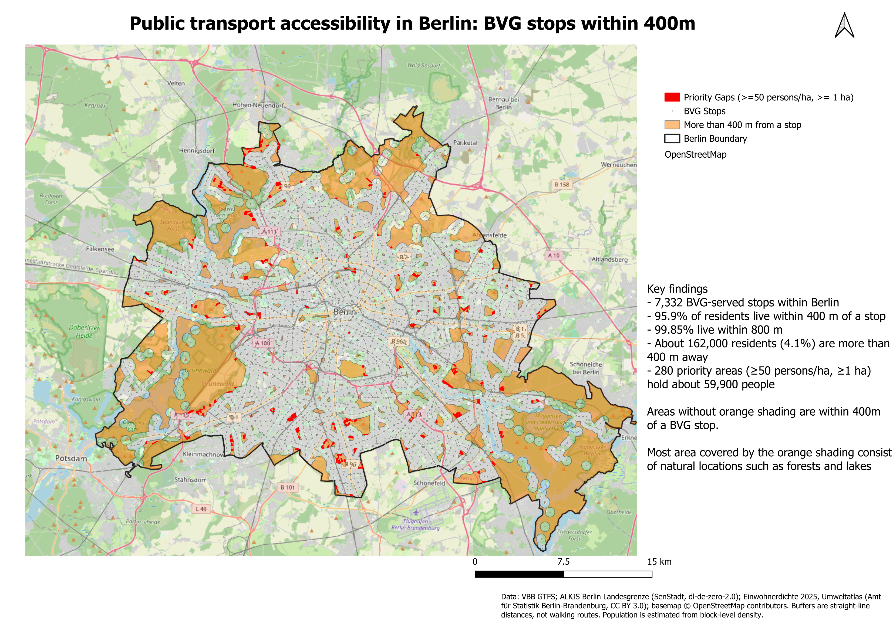

# BVG Public Transport Accessibility in Berlin

A QGIS analysis of how well Berlin's BVG network serves the city's residents, and where the biggest service gaps are.



## Key findings

| Distance to nearest BVG stop | Residents covered | Share of Berlin |
| --- | --- | --- |
| 400 m | 3,750,666 | 95.9% |
| 800 m | 3,905,652 | 99.85% |

- Berlin has about 3.91 million residents; about 162,000 (4.1%) live more than 400 m from a BVG stop.
- About 31% of Berlin's area is beyond 400 m, mostly forests and lakes.
- 280 priority gaps (at least 1 ha and at least 50 persons/ha) hold about 59,900 people, 37% of everyone beyond 400 m.

The full write-up is in [`BVG_Accessibility_Report.pdf`](BVG_Accessibility_Report.pdf).

## Data

| Dataset | Source |
| --- | --- |
| BVG stops, routes, trips | [VBB open GTFS feed](https://unternehmen.vbb.de/digitale-services/datensaetze/) |
| City boundary | ALKIS Berlin Landesgrenze (WFS, gdi.berlin.de) |
| Population density | Einwohnerdichte 2025, Umweltatlas Berlin (WFS, gdi.berlin.de) |

## Method

1. Join GTFS routes, trips, stop times and stops; keep BVG stops (7,637, of which 7,332 are inside Berlin).
2. Tag each stop with its mode from the GTFS `route_type` (400 U-Bahn, 700 bus, 900 tram, 1000 ferry).
3. Reproject everything to EPSG:25833 (ETRS89 / UTM 33N) for metric buffers.
4. Buffer stops by 400 m and 800 m and dissolve.
5. Residents covered = density x area of each block inside the buffer.
6. Gap areas = Berlin minus the 400 m buffer; priority gaps = gap pieces of at least 1 ha with density of at least 50 persons/ha.
7. Lay out the final map in the QGIS Print Layout.

## Limitations

- Straight-line distance overstates real walking access.
- Counts stops only, not frequency or operating hours.
- BVG only: S-Bahn and regional rail are not counted.
- Stops were clipped to Berlin before buffering, so gaps along the city border may be overstated.
- Population is a block average, so resident counts are estimates.

## Repository structure

```
.
├── README.md
├── BVG_Accessibility_Report.pdf
└── 04_Maps/            exported map (PNG / PDF)
```

Add the GeoPackages from `03_Analysis/` only if they are small; check file sizes first (GitHub rejects files over 100 MB).

## Author

Sanju John Barla
